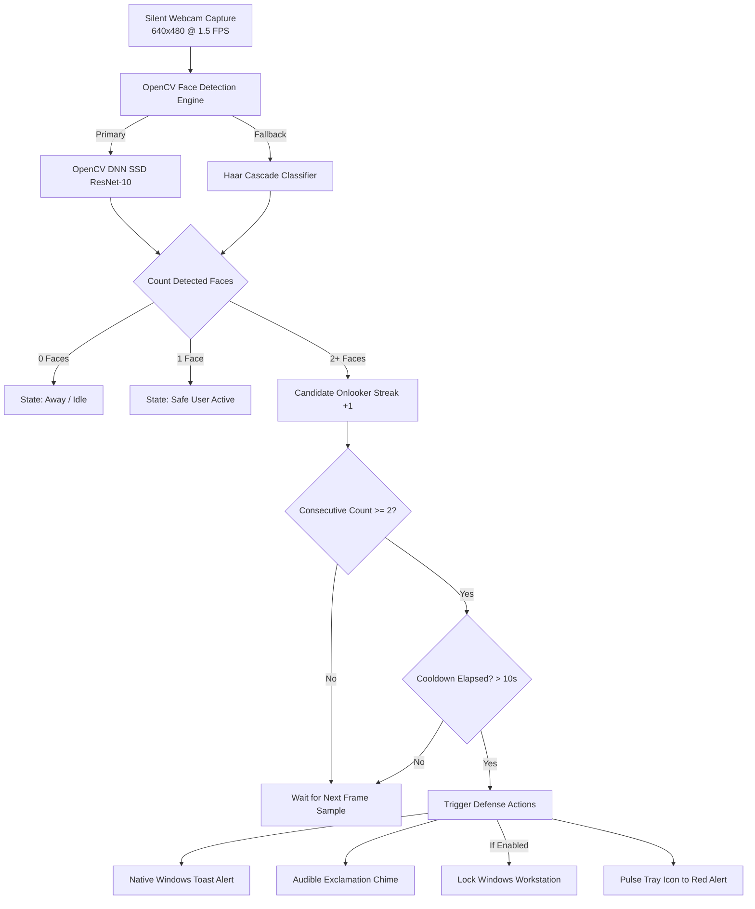

<div align="center">

# 🛡️ Blind-Spotter

**Stealthy onlooker & shoulder-surfing detection for your desktop.**

*An Ashnif Arnob Product*

[](LICENSE)
[](https://microsoft.com)
[](https://python.org)
[](#-privacy--security-manifesto)
[](#-features)

</div>

---

## 📖 Overview

Working on confidential code, financial dashboards, or personal messages in public coffee shops, shared workspaces, or open offices leaves your screen vulnerable to **shoulder-surfing**.

**Blind-Spotter** is an ultra-lightweight, background desktop utility for Windows that watches your back. Using silent, low-rate computer vision via your webcam, it monitors for unexpected onlookers peeking over your shoulder and immediately warns you with native Windows alerts—or locks your screen automatically.

---

## ✨ Features

- 👁️ **Silent Background Tray App:** Runs quietly in the Windows notification area (System Tray). No annoying console windows, no pop-up video previews, and zero clutter.
- 📦 **Single-File Windows Installer:** Instant, zero-dependency installation via `installer.exe` or `Blind-Spotter-Setup.exe`. Installs per-user without requiring administrator privileges or Python!
- ⚡ **Dual-Engine Face Detector:**
  - **Primary:** High-accuracy OpenCV DNN Single Shot MultiBox Detector (SSD) with ResNet-10.
  - **Fallback:** Built-in OpenCV Haar Cascade for instant, zero-dependency reliability.
- 🧠 **Temporal Anti-Flicker Filter:** Requires consecutive positive detections before triggering an alert, eliminating false alarms caused by people briefly passing by.
- 🛡️ **Enterprise-Ready Process Safety:**
  - **Windows Named Mutex:** Prevents duplicate background processes from colliding on webcam capture.
  - **User Profile Isolation:** Stores settings in `%APPDATA%\Blind-Spotter` and rotating diagnostics logs in `%LOCALAPPDATA%\Blind-Spotter\logs`.
  - **Camera Re-acquisition:** Automatically handles laptop sleep/wake cycles and camera reconnections.
- 🔋 **CPU & Battery Optimized:** Samples only 1–2 frames per second at 640x480 resolution, using less than 1% CPU on modern processors.
- 🔔 **Native Windows Alerts:**
  - Native Windows 10 & 11 Toast Notifications with audible exclamation chime.
  - Optional **Automatic Screen Lock** (`LockWorkStation`) to protect confidential data instantaneously.
- ⚙️ **Modern Dark-Mode Settings GUI:** Easily adjust cooldown timers, detection sensitivity, camera index, sound, screen-lock, and Windows startup toggles.
- 🔕 **One-Click Pause / Resume:** Easily pause detection during team meetings or video calls right from the system tray menu.
- 🔒 **100% Local & Privacy-First:** No frames or facial data are ever saved to disk or transmitted over the internet.

---

## 🏗️ Architecture & Workflow



---

## 📂 Project Structure

```
Blind-Spotter/
├── assets/
│   └── icon.png                  # Stealth logo & application branding
├── models/
│   ├── deploy.prototxt           # Caffe model architecture definition
│   └── res10_300x300_ssd_iter_140000_fp16.caffemodel # Pre-trained DNN weights
├── src/
│   ├── __init__.py               # Package metadata
│   ├── config.py                 # Thread-safe config.json management
│   ├── detector.py               # Background CV engine & temporal logic
│   ├── notifier.py               # Windows toast, sound, & LockWorkStation API
│   ├── settings_dialog.py        # Dark-mode Tkinter settings panel
│   └── tray.py                   # Pystray tray icon & dynamic context menu
├── tests/
│   ├── __init__.py               # Test package marker
│   ├── test_config.py            # Configuration validation tests
│   ├── test_detector.py          # CV engine & state machine tests
│   ├── test_notifier.py          # Notification & alert dispatch tests
│   └── test_tray.py              # System tray & icon generator tests
├── config.json                   # User runtime configuration
├── main.py                       # Main application entrypoint
├── requirements.txt              # Dependencies (opencv-python, pillow, pystray, plyer)
├── run.bat                       # Interactive batch runner & debug launcher
├── run_silent.vbs                # Fully invisible background launcher
├── LICENSE                       # MIT License (c) 2026 Ashnif Arnob
└── README.md                     # Documentation
```

---

## 🚀 Getting Started

### Option A: Standalone Windows Installer (Recommended for End Users)
No Python, Git, or developer dependencies required!

1. Download or locate `Blind-Spotter-Setup.exe` (or `installer.exe`).
2. Double-click the installer.
3. Choose your options (Desktop shortcut, Start Menu shortcut, Start with Windows) and click **Install Now**.
4. Blind-Spotter installs to your user profile (`%LOCALAPPDATA%\Programs\Blind-Spotter`) and runs immediately in your System Tray!

#### Silent Enterprise Deployment (IT Admins):
To deploy headlessly via PowerShell, SCCM, or Microsoft Intune:
```powershell
installer.exe /S
```

---

### Option B: Developer Setup (From Source)

#### 1. Prerequisites
- **Operating System:** Windows 10 or Windows 11 (64-bit)
- **Python:** Python 3.9 or higher (Python 3.12+ recommended)
- **Webcam:** Any built-in or USB webcam

#### 2. Installation
Clone this repository and navigate into the folder:
```powershell
git clone https://github.com/viper149/Blind-Spotter.git
cd Blind-Spotter
```

Install the required Python packages:
```powershell
pip install -r requirements.txt
```

#### 3. Running Unit Tests
Verify all components and test suites:
```powershell
python -m unittest discover -s tests -v
```

---

## 🎮 How to Run (From Source)

### Method 1: Invisible Silent Background Mode
Double-click `run_silent.vbs`.
- Starts **Blind-Spotter** with zero command prompts or flashing console windows.
- The stealth eye icon will appear in your Windows System Tray (near the clock).

### Method 2: Console Debug Runner
Double-click `run.bat` or run in terminal:
```powershell
python main.py
```
This runs the application with live logging enabled in your console.

---

## ⚙️ Configuration & System Tray Controls

Right-click the **Blind-Spotter** icon in your System Tray to access:
- **Status Display:** Shows whether monitoring is `Active` or `Paused`, and which detection engine is running.
- **Pause / Resume Monitoring:** Temporarily pause webcam polling (turns off the camera).
- **Settings (Adjust Cooldown)...:** Opens the configuration GUI:
  - **Alert Cooldown:** Minimum delay (3s–60s) between consecutive alerts to prevent notification spam.
  - **Consecutive Frames:** Number of confirmed frames required before alerting (default: 2 frames).
  - **Detection Confidence:** Sensitivity slider for the neural network (default: 50%).
  - **Camera Index:** Switch webcams if you have multiple cameras plugged in (0 = default).
  - **Audio Chime:** Toggle audible sound on/off.
  - **Workstation Auto-Lock:** Instantly lock Windows when an onlooker is confirmed.
  - **Test Alert:** Verify toast notification and sound without triggering a false alarm.
- **Exit:** Stops the detector, safely closes the webcam, and removes the tray icon.

---

## 🔄 Auto-Start with Windows (Optional)

To have Blind-Spotter launch automatically whenever you log into Windows:
1. Press `Win + R`, type `shell:startup`, and press **Enter**.
2. Right-click inside the Startup folder and choose **New > Shortcut**.
3. Browse to and select `run_silent.vbs` inside your `Blind-Spotter` folder.
4. Click **Next** and **Finish**.

---

## 🔐 Privacy & Security Manifesto

Your privacy is paramount:
1. **100% On-Device:** All computer vision calculations happen locally on your CPU via OpenCV.
2. **Zero Network Transmission:** No video frames, telemetry, or metadata are ever transmitted over the network.
3. **Zero Image Storage:** Frames captured from the webcam are processed in volatile memory and immediately discarded. No photos or video clips are ever saved to disk.
4. **Camera Courtesy:** Pausing or exiting the application releases the webcam handle immediately.

---

## 📜 License & Attribution

Distributed under the **MIT License**. See [LICENSE](LICENSE) for details.

```
Copyright (c) 2026 Ashnif Arnob. All rights reserved.
```

**An Ashnif Arnob Product**  
*Crafted for security-conscious professionals and privacy enthusiasts.*
